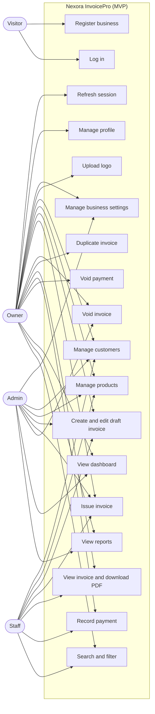
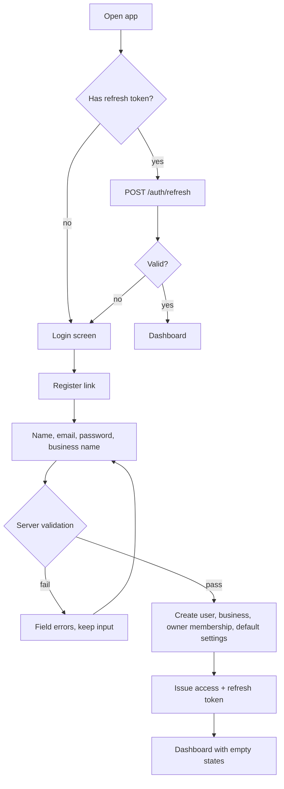
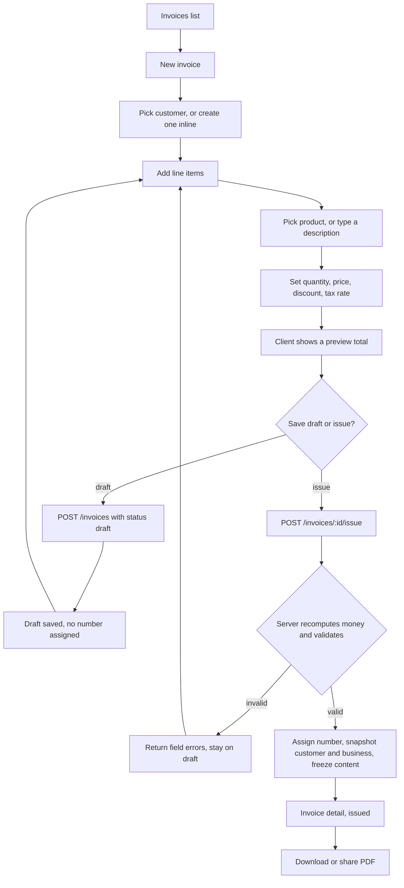
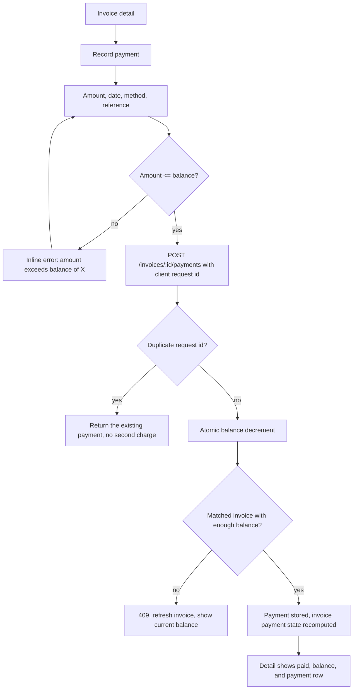
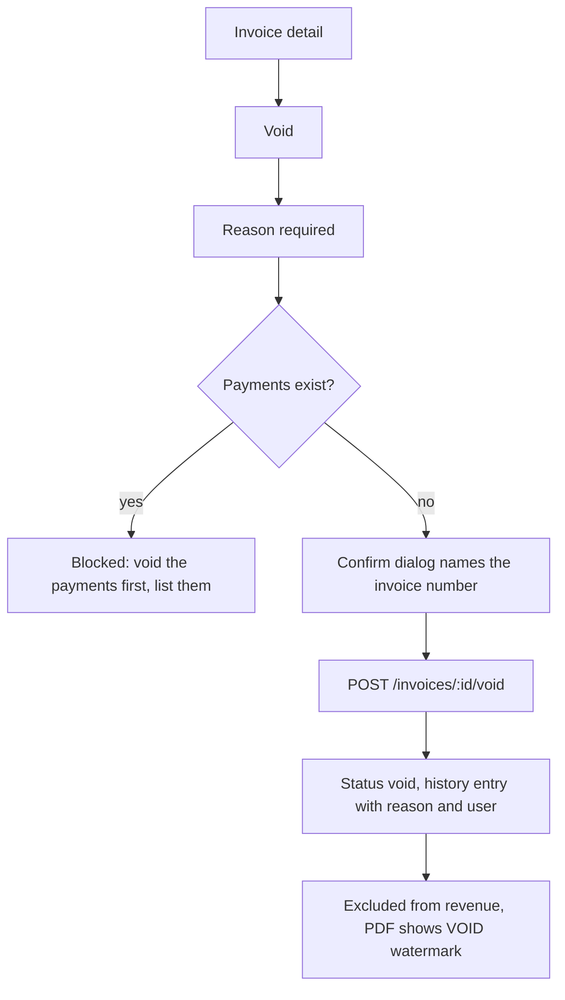
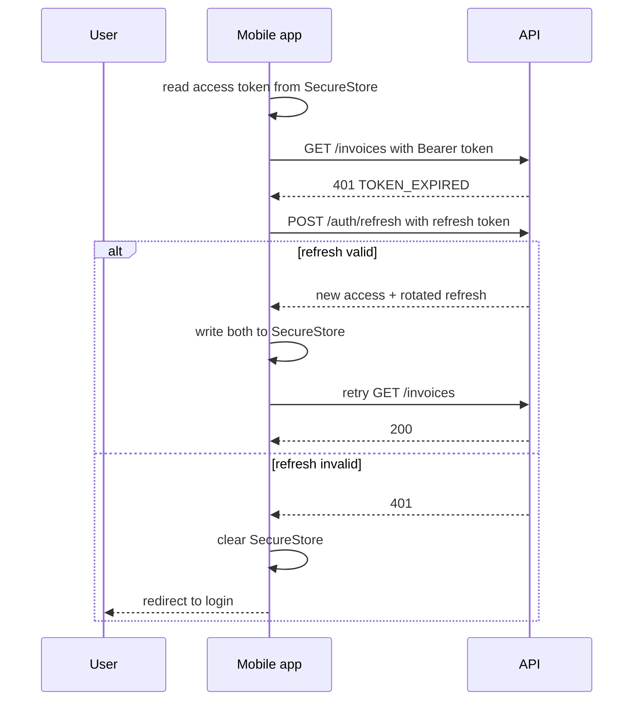

# Stage 1 - Users, use cases and flows

## Actors

| Actor | Description |
| --- | --- |
| Visitor | Not signed in. Can register or log in. |
| Owner | Created the business. Full access including settings, void, delete. |
| Admin | Team member with settings and delete rights. Post-MVP UI. |
| Staff | Team member who can create customers, products, invoices and payments. Post-MVP UI. |
| Scheduler | Server-side clock that makes invoices overdue. Derived at read time, no job needed. |

## Use case diagram

## Flow 1 - First run

The dashboard for a brand new account shows three empty-state cards: no customers, no products, no invoices. Each card links to the matching create form. No placeholder numbers appear.

## Flow 2 - Raise and issue an invoice

The preview total on the client uses the same shared money functions as the server, so the number the user sees is the number the server stores. The server still ignores whatever total the client sends.

## Flow 3 - Record a part payment

## Flow 4 - Void

Voided invoices stay in the list behind the "void" filter. Nothing is deleted, because the number was issued and the record has to survive.

## Flow 5 - Session expiry on mobile

Refresh happens once per failure and is shared across concurrent requests, so ten parallel calls do not start ten refreshes.

## Flow 6 - Tenant isolation check

Every request that touches a business record follows this path:

1. Token verified. `req.auth = { userId, businessId, role }`.
2. The route handler reads `businessId` from `req.auth`. It never reads a business ID from the body, query string, or path.
3. The database query includes `businessId` in its filter.
4. A miss returns 404, not 403, so the API does not confirm that a foreign record exists.

The test suite asserts this for customers, products, invoices and payments by creating two accounts and trying each cross-tenant read, update and delete.
