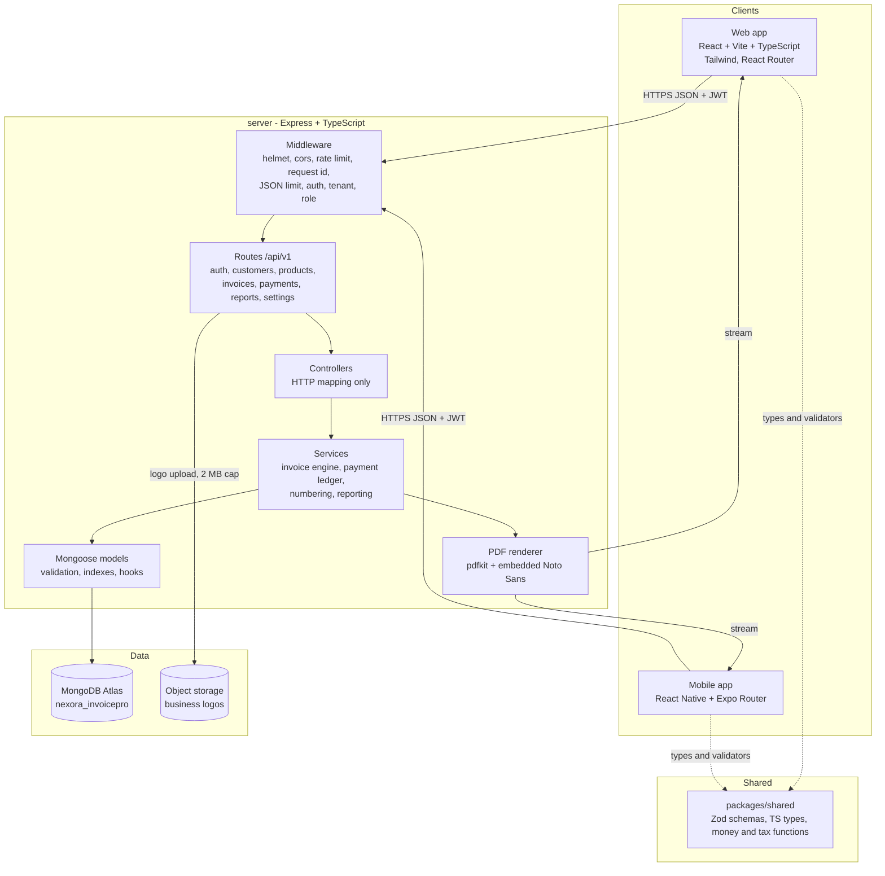
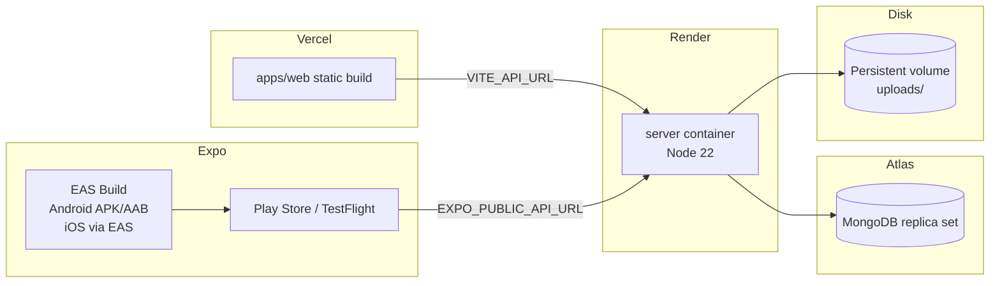
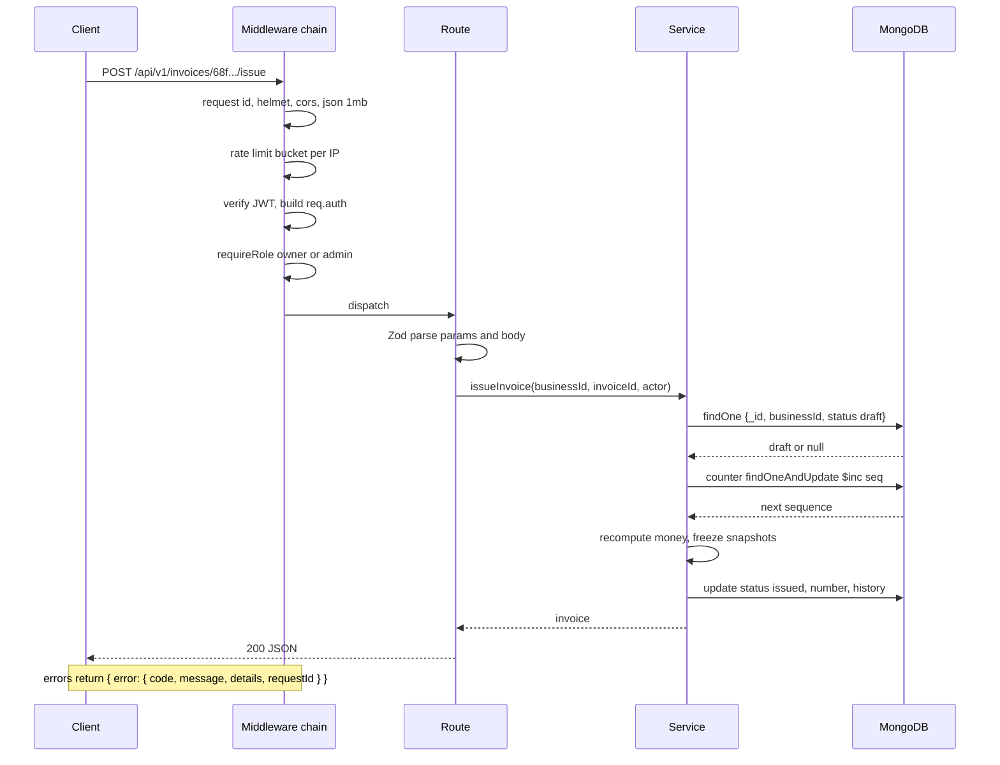

# Stage 1 - Architecture

## System diagram



The web app and the mobile app share one contract package. A schema change that breaks a client fails typecheck in that client instead of failing at runtime in production.

## Deployment view



Render free instances sleep. The README documents a cold start of about 30 seconds and the mobile app shows a "waking server" message on the first failed request rather than an error.

## Request lifecycle



## Authentication design

| Concern | Decision |
| --- | --- |
| Password hash | argon2id, memory cost 19456 KiB, time cost 2, parallelism 1 |
| Access token | JWT HS256, 15 minutes, claims `sub`, `bid`, `role`, `ver` |
| Refresh token | 32 random bytes, base64url, stored as SHA-256 hash with `familyId`, 30 day TTL |
| Rotation | Every refresh issues a new token and marks the old one used. A used token presented again revokes the family. |
| Web transport | Refresh token in `httpOnly`, `Secure` in production, `SameSite=Strict`, `Path=/api/v1/auth` cookie |
| Mobile transport | Refresh token in Expo SecureStore, sent in the request body with header `X-Client-Platform: mobile` |
| Access transport | `Authorization: Bearer` on both clients, kept in memory only |
| CSRF | Cookie endpoints are `SameSite=Strict` and reject requests whose `Origin` is not in the allowlist |
| Logout | Revokes the presented refresh token, clears the cookie |
| Password change | Revokes every refresh token for the user, forces re-login on all devices |

Access tokens live in memory on web, so a page reload triggers one refresh. That is a deliberate trade: nothing script-readable sits in localStorage.

## Tenancy rules

`Business` is the tenant. `Membership` joins `User` to `Business` with a role. Every business-owned collection stores a `businessId` field with an index.

Rules enforced in code review and tests:

1. `businessId` comes only from `req.auth`.
2. Every query and every `updateOne` includes `businessId` in the filter.
3. Reference checks are scoped: a customer ID from another business fails the same scoped query.
4. Cross-tenant access returns 404.
5. Aggregations start with `$match: { businessId }`.
6. The PDF endpoint resolves the invoice through the scoped query.

## Modules and boundaries

The server keeps three layers, and the dependency direction only goes one way.

- Controllers read `req`, call one service function, and shape the response. No queries.
- Services hold business rules: money, numbering, status transitions, payment balance. No Express types.
- Models define schema, indexes and simple helpers. No cross-collection business logic.

Why it matters: the invoice engine and the payment ledger are where money bugs live. Keeping them free of Express types lets the test suite call them directly with plain objects, without spinning up HTTP.

## Repository layout

```
Invoice_Generator/
  apps/
    web/                     React + Vite + Tailwind
      src/
        app/                 router, layouts, providers
        features/            auth, dashboard, customers, products,
                             invoices, payments, reports, settings
        components/ui/       button, input, table, dialog, badge, toast, empty
        lib/                 api client, formatting, query hooks
    mobile/                  Expo + Expo Router
      app/                   file-based routes
      src/                   api client, secure storage, shared ui
  packages/
    shared/                  Zod schemas, types, money math, tax math, constants
      src/
  server/
    src/
      config/                env parsing, db connection, logger
      middleware/            auth, tenant, role, error, rate limit, upload
      models/               user, business, membership, settings, customer,
                            product, invoice, payment, counter, refresh token, audit
      services/              auth, invoice, payment, numbering, report, pdf
      routes/                v1 routers
      docs/                  openapi.ts
      tests/                 unit and api
  docs/                      this folder
  .gitignore
  README.md
  package.json               npm workspaces
```

The repo root is the project root, so `apps/`, `packages/` and `server/` sit directly in `Invoice_Generator` instead of a nested `nexora-invoicepro/` folder.

npm workspaces with npm 11. No Turborepo or Nx: three packages and one server do not need a task graph, and a smaller toolchain is easier to explain in a portfolio.

## API conventions

- Base path `/api/v1`. Version in the path, so a future breaking change can ship as `/api/v2` without breaking installed mobile builds.
- JSON only. `Content-Type: application/json` except the logo upload and the PDF.
- Success returns the resource or `{ items, page, pageSize, total, totalPages }`.
- Errors return `{ error: { code, message, details?, requestId } }` with a stable machine code such as `VALIDATION_FAILED`, `INSUFFICIENT_BALANCE`, `INVOICE_NOT_DRAFT`.
- List queries accept `page` (1-based), `pageSize` (default 20, max 100), `sort` (for example `-issueDate`), `q`.
- Unknown query keys are rejected so typos surface instead of being silently ignored.
- Request IDs come from `X-Request-Id` or are generated, echoed in the response header and in every error.
- `Idempotency-Key` on payment creation.

## Security controls

| Control | Implementation |
| --- | --- |
| Headers | helmet with a strict CSP for the API (no HTML served) |
| CORS | allowlist from `WEB_ORIGIN`, credentials enabled, explicit methods |
| Body size | `express.json({ limit: '1mb' })` |
| Rate limits | 300/min per IP globally, 10 per 15 min on login and register per IP, 5 per hour on password reset per IP |
| Input validation | Zod at the route boundary, unknown keys stripped, numbers coerced and bounded |
| Uploads | images only, signature check, 2 MB, random filename, no original name on disk |
| Secrets | `.env` never committed, `.env.example` with empty values, env parsed at boot and the process exits on a missing required key |
| Logging | pino with redaction of `authorization`, `cookie`, `password`, `refreshToken` |
| PDF | text escaped for the PDF layer, control characters stripped, no file paths from user input |

No claim here that the system is unbreakable. These are the controls the tests can prove. Anything untested is listed as untested in the README.

## Technical decisions worth recording

**Money as integers.** Float rupees produce totals that disagree with the printed invoice by a paisa after enough lines. Integer paise plus integer arithmetic removes that class of bug and makes tests exact.

**Server-computed totals.** A client that sends `totalMinor` is ignored. The invoice engine derives everything from quantity, price, discount and rate inputs.

**Derived payment state.** Storing `overdue` as a status needs a nightly job and goes stale between runs. Computing it from due date and balance is always correct.

**Conditional update for payments instead of a transaction.** `findOneAndUpdate({ _id, businessId, balanceDueMinor: { $gte: amount } }, { $inc: { amountPaidMinor: amount, balanceDueMinor: -amount } })` is atomic on a single document. Two concurrent payments cannot both overdraw. This avoids requiring a replica set for local development, which is one less setup step on Windows.

**Snapshots on issue.** An issued invoice must not change when a customer edits their address or a product changes price. Business and customer details, line descriptions, prices and rates are copied into the invoice at issue time.

**Counter document for numbering.** A per-business, per-fiscal-year counter with `$inc` and a unique index assigns numbers without collisions under concurrency.

**PDF server-side.** Browser print is inconsistent across engines and the mobile app cannot print HTML. One server renderer gives identical output everywhere.

## Environment variables

Server, in `server/.env`:

```
NODE_ENV=development
PORT=4000
MONGODB_URI=mongodb+srv://...
JWT_ACCESS_SECRET=
JWT_REFRESH_SECRET=
ACCESS_TOKEN_TTL=15m
REFRESH_TOKEN_TTL_DAYS=30
WEB_ORIGIN=http://localhost:5173
UPLOAD_DIR=./uploads
MAX_UPLOAD_BYTES=2097152
SMTP_HOST=
SMTP_PORT=
SMTP_USER=
SMTP_PASS=
MAIL_FROM=
```

Web, in `apps/web/.env`:

```
VITE_API_URL=http://localhost:4000/api/v1
```

Mobile, in `apps/mobile/.env`:

```
EXPO_PUBLIC_API_URL=http://localhost:4000/api/v1
```

On an Android emulator `localhost` is the emulator itself, so the value becomes `http://10.0.2.2:4000/api/v1`. On a physical device it becomes the machine's LAN address, `http://192.168.x.x:4000/api/v1`, and the API must bind to `0.0.0.0`. Stage 5 covers this with the exact steps.
