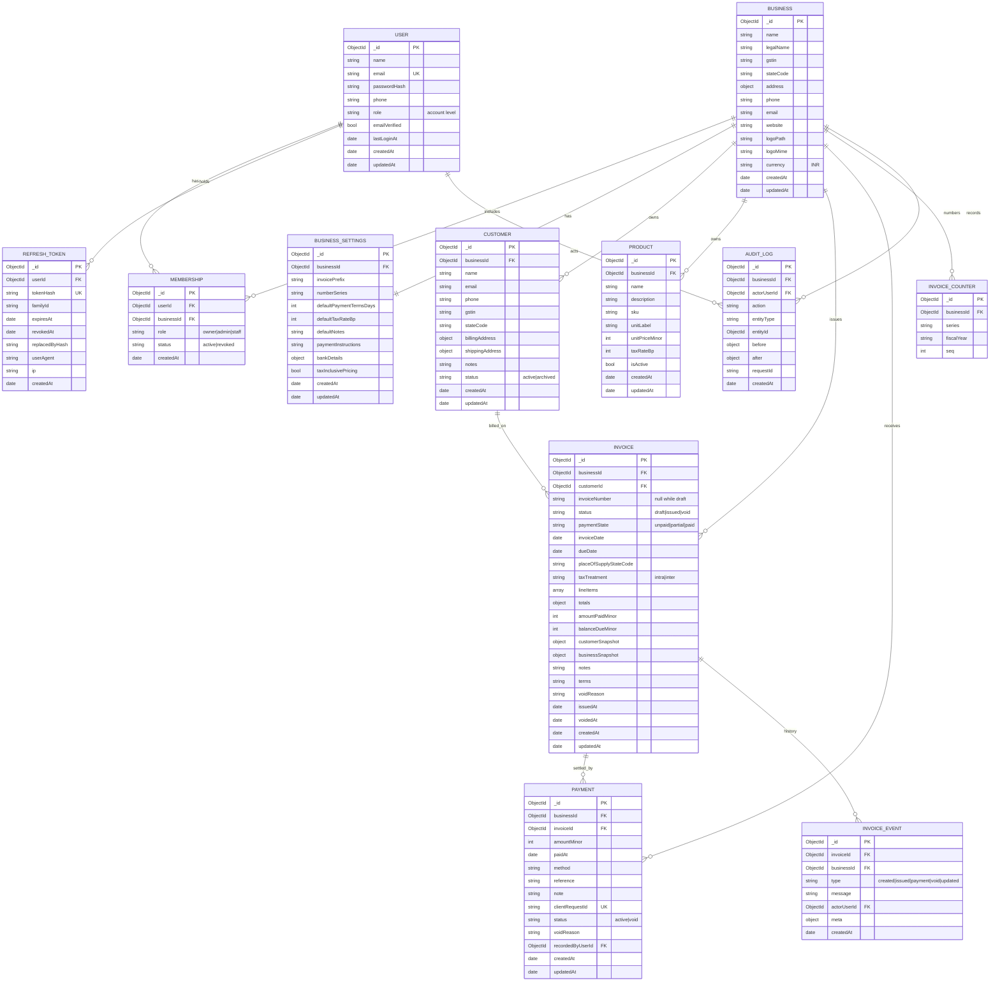

# Stage 1 - Database design

## ER diagram



Mermaid renders `INVOICE_EVENT` as its own table. In MongoDB it is embedded inside the invoice as `events`, not a separate collection, because it is only ever read with its invoice and never queried across invoices.

## Tenant ownership

| Collection | Tenant field | Notes |
| --- | --- | --- |
| User | none | Global identity, not business owned |
| Business | itself | The tenant root |
| Membership | `businessId` | Join table, scoped |
| BusinessSettings | `businessId` | One per business |
| Customer | `businessId` | Required, indexed |
| Product | `businessId` | Required, indexed |
| Invoice | `businessId` | Required, indexed |
| Payment | `businessId` and `invoiceId` | Both required, so a scoped query can never leak |
| InvoiceCounter | `businessId` | Unique on business plus series plus fiscal year |
| RefreshToken | none | Belongs to a user, not a business |
| AuditLog | `businessId` | Plus `actorUserId` |

Every service function takes `businessId` as its first argument after the actor. It is not optional and has no default.

## Collection details

### users

| Field | Type | Rules |
| --- | --- | --- |
| `name` | string | 2 to 80 chars, trimmed |
| `email` | string | lowercase, unique, valid email |
| `passwordHash` | string | argon2id, `select: false` |
| `phone` | string | optional, 8 to 15 digits with optional `+` |
| `lastLoginAt` | Date | updated on successful login |
| `createdAt`, `updatedAt` | Date | timestamps |

Indexes: `{ email: 1 }` unique.

`passwordHash` is excluded from queries by default and only pulled with `.select('+passwordHash')` in the login and password-change services.

### businesses

| Field | Type | Rules |
| --- | --- | --- |
| `name` | string | 2 to 120 chars |
| `legalName` | string | optional |
| `gstin` | string | optional, 15 chars, format `^[0-9]{2}[A-Z]{5}[0-9]{4}[A-Z][1-9A-Z]Z[0-9A-Z]$` |
| `stateCode` | string | 2 digits, from the GST state list, required |
| `address` | object | `line1`, `line2`, `city`, `state`, `pincode`, `country` |
| `phone`, `email`, `website` | string | optional |
| `logoPath` | string | server-generated filename only |
| `logoMime` | string | `image/jpeg` or `image/png` or `image/webp` |
| `currency` | string | fixed `INR` in MVP |

Indexes: none beyond `_id`. Lookup is always by `_id` from the token.

### memberships

| Field | Type | Rules |
| --- | --- | --- |
| `userId` | ObjectId | required |
| `businessId` | ObjectId | required |
| `role` | enum | `owner`, `admin`, `staff` |
| `status` | enum | `active`, `revoked` |

Indexes: `{ userId: 1, status: 1 }`, `{ businessId: 1, role: 1 }`, `{ userId: 1, businessId: 1 }` unique.

The access token carries `bid` and `role`. The auth middleware verifies that the membership still exists and is active, so revoking access takes effect within one access-token lifetime. Accepted trade for the MVP; a `tokenVersion` on the user shortens that for password changes.

### business_settings

| Field | Type | Default |
| --- | --- | --- |
| `invoicePrefix` | string | `NXP` |
| `numberSeries` | string | `INV` |
| `defaultPaymentTermsDays` | int | `15` |
| `defaultTaxRateBp` | int | `1800` |
| `defaultNotes` | string | `Thank you for your business.` |
| `paymentInstructions` | string | empty |
| `bankDetails` | object | account name, number, IFSC, bank, UPI ID |
| `taxInclusivePricing` | bool | `false` |

Index: `{ businessId: 1 }` unique.

`invoicePrefix` is limited to 3 to 8 uppercase alphanumerics. It appears in the PDF and in the number, so characters that break a filename or a URL are rejected.

### customers

| Field | Type | Rules |
| --- | --- | --- |
| `name` | string | 2 to 120 chars, required |
| `email` | string | optional, valid email |
| `phone` | string | optional |
| `gstin` | string | optional, same pattern as business |
| `stateCode` | string | optional, defaults to business state on invoice creation |
| `billingAddress` | object | same shape as business address |
| `shippingAddress` | object | optional |
| `notes` | string | up to 1000 chars |
| `status` | enum | `active`, `archived` |

Indexes: `{ businessId: 1, status: 1, name: 1 }`, `{ businessId: 1, email: 1 }`, and a text index on `name`, `email`, `phone`, `gstin` for search. Search runs a case-insensitive regex on an anchored prefix for short queries, and the text index for longer ones. Simpler alternative if the text index proves noisy: a single compound index on `{ businessId: 1, name: 1 }` plus regex. Stage 3 measures and picks one.

### products

| Field | Type | Rules |
| --- | --- | --- |
| `name` | string | 2 to 120 chars |
| `description` | string | up to 500 chars |
| `sku` | string | optional, up to 40 chars, unique per business when set |
| `unitLabel` | string | default `unit`, examples: `hour`, `piece`, `month` |
| `unitPriceMinor` | int | 0 to 1,000,000,000 paise (INR 1 crore) |
| `taxRateBp` | int | 0 to 2800, must be one of the GST slabs by default: 0, 500, 1200, 1800, 2800 |
| `isActive` | bool | default true |

Indexes: `{ businessId: 1, isActive: 1, name: 1 }`, `{ businessId: 1, sku: 1 }` unique sparse, `{ businessId: 1, name: 1 }`.

### invoices

| Field | Type | Notes |
| --- | --- | --- |
| `invoiceNumber` | string | null while draft, unique per business once issued |
| `status` | enum | `draft`, `issued`, `void` |
| `paymentState` | enum | `unpaid`, `partial`, `paid`, derived on every payment change |
| `invoiceDate` | Date | plain date at midnight IST |
| `dueDate` | Date | must be on or after `invoiceDate` |
| `placeOfSupplyStateCode` | string | 2 digits |
| `taxTreatment` | enum | `intra`, `inter` |
| `lineItems` | array | see below |
| `totals` | object | see below |
| `amountPaidMinor` | int | denormalised from active payments |
| `balanceDueMinor` | int | `totals.totalMinor - amountPaidMinor` |
| `customerSnapshot` | object | name, gstin, email, phone, billing address, state code as of issue |
| `businessSnapshot` | object | name, gstin, address, phone, email, logo reference, bank details as of issue |
| `notes`, `terms` | string | up to 2000 chars each |
| `voidReason` | string | required when voiding |
| `issuedAt`, `voidedAt` | Date | null until the transition |
| `events` | array | embedded history, append only |

Line item subdocument:

```
{
  lineNo: 1,
  productId: ObjectId | null,
  description: "Website redesign, 5 pages",
  hsnSac: "998314",
  unitLabel: "project",
  quantityMilli: 1000,
  unitPriceMinor: 2500000,
  discountBp: 0,
  discountMinor: 0,
  grossMinor: 2500000,
  taxableMinor: 2500000,
  taxRateBp: 1800,
  cgstMinor: 225000,
  sgstMinor: 225000,
  igstMinor: 0,
  taxMinor: 450000,
  lineTotalMinor: 2950000
}
```

Totals subdocument:

```
{
  subtotalMinor: 2500000,
  discountTotalMinor: 0,
  taxableTotalMinor: 2500000,
  cgstTotalMinor: 225000,
  sgstTotalMinor: 225000,
  igstTotalMinor: 0,
  taxTotalMinor: 450000,
  roundOffMinor: 0,
  totalMinor: 2950000
}
```

Indexes:
- `{ businessId: 1, invoiceNumber: 1 }` unique partial where `invoiceNumber` is a string
- `{ businessId: 1, status: 1, invoiceDate: -1 }`
- `{ businessId: 1, paymentState: 1, dueDate: 1 }`
- `{ businessId: 1, customerId: 1, invoiceDate: -1 }`
- `{ businessId: 1, dueDate: 1, balanceDueMinor: 1 }` for the overdue query

`roundOffMinor` is 0 in the MVP. The field exists so a future "round total to nearest rupee" setting does not need a migration.

### payments

| Field | Type | Notes |
| --- | --- | --- |
| `amountMinor` | int | greater than 0 |
| `paidAt` | Date | not in the future beyond one day |
| `method` | enum | `cash`, `upi`, `bank_transfer`, `cheque`, `card`, `other` |
| `reference` | string | UTR, cheque number, UPI ref |
| `note` | string | optional |
| `clientRequestId` | string | UUID from the client, `Idempotency-Key` header |
| `status` | enum | `active`, `void` |
| `voidReason` | string | required when void |
| `recordedByUserId` | ObjectId | actor |

Indexes: `{ businessId: 1, invoiceId: 1, createdAt: -1 }`, `{ businessId: 1, clientRequestId: 1 }` unique, `{ businessId: 1, paidAt: -1 }`.

### invoice_counters

| Field | Type |
| --- | --- |
| `businessId` | ObjectId |
| `series` | string, for example `INV` |
| `fiscalYear` | string, for example `2026-27` |
| `seq` | int |

Index: `{ businessId: 1, series: 1, fiscalYear: 1 }` unique.

Assignment runs one atomic `findOneAndUpdate` with `$inc: { seq: 1 }`, `upsert: true`, `new: true`, then retries once on a duplicate-key error from two simultaneous upserts. Retry is bounded to three attempts and then fails loudly.

Fiscal year is derived from the issue date in IST: April to March, labelled `2026-27`.

Number format: `{prefix}/{fiscalYear}/{seq padded to 4}`, for example `NXP/2026-27/0007`. Above 9999 the padding grows rather than truncating.

### refresh_tokens

| Field | Type | Notes |
| --- | --- | --- |
| `userId` | ObjectId | |
| `tokenHash` | string | SHA-256 of the raw token, unique |
| `familyId` | string | shared by a rotation chain |
| `expiresAt` | Date | TTL index |
| `revokedAt` | Date | null when active |
| `replacedByHash` | string | set on rotation, used for reuse detection |
| `userAgent`, `ip` | string | for the session list |

Indexes: `{ tokenHash: 1 }` unique, `{ userId: 1, revokedAt: 1 }`, `{ expiresAt: 1 }` with `expireAfterSeconds: 0`.

### audit_logs

Append-only. `action` values: `invoice.issue`, `invoice.void`, `payment.create`, `payment.void`, `settings.update`, `logo.upload`, `member.role_change`. Stores `before` and `after` diffs of the changed fields only, not whole documents, to keep the collection small.

Indexes: `{ businessId: 1, createdAt: -1 }`, `{ businessId: 1, entityType: 1, entityId: 1 }`.

## Why snapshots and not only references

An issued invoice is a legal-ish document. If the customer moves office or the business changes its GSTIN, last year's invoice must still show what was true on the issue date. The invoice therefore stores copies of the customer and business details, and copies every line's description, price and rate. References stay for reporting and linking, but rendering and totals read the snapshot.

Consequence: editing a customer never rewrites history, which is the behaviour the tests assert.

## Seed data

`npm run seed` in `server` creates:

- One user `demo@nexora.test` with a known password from `.env`.
- Business `Nexora Technologies`, state 24 (Gujarat), GSTIN placeholder.
- 6 customers across two states, so both intra-state and inter-state tax paths are exercised.
- 8 products across GST slabs 0, 5, 12, 18.
- 12 invoices: 4 paid, 3 partial, 2 unpaid and not due, 2 overdue, 1 draft, 1 void.
- Payments matching the paid and partial invoices.

The seed refuses to run when `NODE_ENV=production`. Every seeded record is real data in the database, and the UI never invents figures.

## Migration stance

No migration framework for MVP. Schema changes ship with a small script in `server/scripts/` that reads, transforms and writes, and the change is recorded in `docs/04-database-design.md`. Mongoose `strict` mode rejects unknown fields, so a client sending a new field fails loudly instead of silently storing junk.
